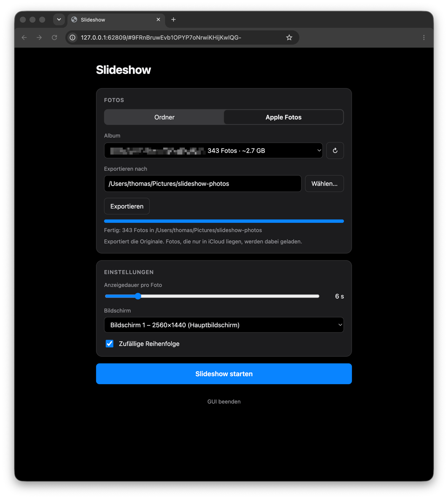

# slideshow

> **Fork notice:** This is a fork of [bhicks329/slideshow](https://github.com/bhicks329/slideshow) by Ben Hicks. It adds a browser GUI for picking photos, exporting albums and controlling the running slideshow, pause and live delay changes, smoother GPU-rendered Ken Burns motion, and fixes for multi-monitor setups on macOS.

A fullscreen photo slideshow for macOS with Ken Burns pan/zoom effects, cross-fade transitions, and optional face-detection-guided panning.

## Background

Apple Photos' built-in slideshow is great, but it doesn't let you control how long each image is displayed — you get a fixed speed with no way to slow it down. This project was built to fill that gap: a simple, configurable slideshow you can point at any folder of photos and run at whatever pace you like.

## Features

- Configurable slide delay (seconds per photo)
- Ken Burns effect — gentle pan and slight zoom on every image, rendered on the GPU with sub-pixel precision and synced to the display's refresh rate
- 1-second cross-fade transition between slides
- Face detection (Haar cascade) — when a face is found, the pan starts centered on it
- Automatic black-border removal (e.g. screenshots with letterboxing)
- EXIF orientation correction
- Background image preloading for smooth transitions
- Second screen / projector support — the slideshow stays visible while you use your other screens
- Pause and change the delay while it runs
- Loops indefinitely through the photo library
- Built-in Apple Photos export — pick an album in the GUI or from the command line, no manual export needed
- Browser GUI to pick photos, export albums and control the running slideshow

<p align="center">
  
</p>

## Requirements

- macOS (tested on Tahoe 26.6.2)
- Python 3.9+

## Setup

```bash
git clone https://github.com/TheNaderio/slideshow.git
cd slideshow
```

That's it. When you first run `./run.sh`, it will automatically:

1. Check that Python 3.9+ is available (and suggest `brew install python` if not)
2. Create a virtual environment in `venv/`
3. Install all dependencies from `requirements.txt`

To skip the setup check on subsequent runs:

```bash
./run.sh --skip-setup
```

## Usage

### GUI

```bash
./run.sh --gui
```

Or double-click `Slideshow.command` in Finder. This opens a page in your browser where you can:

- pick a photo folder, or export an Apple Photos album with a progress bar
- set the delay, display and shuffle order (remembered for next time)
- start the slideshow and control it while it runs: previous, pause, next, change the delay, stop — without touching the slideshow screen

The GUI is served on `127.0.0.1` only and every request needs a random per-session token from the URL, so it isn't reachable from the network or from other websites. Settings are stored in `~/Library/Application Support/slideshow/settings.json`. Quit with **GUI beenden** on the page or Ctrl+C in the terminal.

### Quickstart — just run it

```bash
./run.sh
```

Runs the slideshow from `~/Pictures/slideshow-photos` (the default export folder) at 4 seconds per photo. Setup is handled automatically on first run.

### Export from Apple Photos and run immediately

```bash
./run.sh --export-and-run
```

This presents an interactive album picker, exports the photos to `~/Pictures/slideshow-photos`, then starts the slideshow automatically.

### Export only

```bash
./run.sh --export
```

Exports the chosen album without starting the slideshow. Useful for preparing photos in advance or checking what was exported before running.

### Run from an existing folder

```bash
./run.sh /path/to/photos
```

Skips export entirely — just runs the slideshow from a folder on disk. This is the mode to use once photos are already exported, and is the most stable option for long-running sessions.

### Options


| Flag           | Applies to   | Default                       | Description                                          |
| -------------- | ------------ | ----------------------------- | ---------------------------------------------------- |
| `--output DIR` | export modes | `~/Pictures/slideshow-photos` | Where exported photos are saved                      |
| `--delay N`    | run modes    | `4`                           | Seconds each slide is shown                          |
| `--no-shuffle` | run modes    | off                           | Show photos in alphabetical order instead of random  |
| `--display N`  | run modes    | `0`                           | Display index (0 = primary, 1 = second screen, etc.) |
| `--skip-setup` | all modes    | off                           | Skip Python environment checks                       |

### Examples

```bash
# Export and run on a second screen at a relaxed pace
./run.sh --export-and-run --display 1 --delay 10

# Export to a custom folder
./run.sh --export --output ~/Desktop/family-photos

# Run from a previously exported folder
./run.sh ~/Pictures/slideshow-photos --delay 8

# Fast-paced, alphabetical order
./run.sh ~/Pictures/slideshow-photos --delay 3 --no-shuffle
```

### What the export step does

When you run `--export` or `--export-and-run`, the script:

1. Connects to Photos and lists all your albums
2. Lets you pick one by number
3. Shows the photo count and estimated disk space required
4. Checks you have enough free space, and warns if it looks tight
5. Exports originals to the output folder, showing a live progress bar
6. Notes any photos that couldn't be downloaded (e.g. iCloud-only items not available offline)

On first run, macOS will prompt you to grant Photos library access — this is expected.

> **Shared albums** (iCloud Shared Albums created by someone else) are not accessible via AppleScript and will not appear in the picker. Export these manually from Photos using **File → Export → Export Unmodified Originals**, then point `run.sh` at the exported folder.
> **iCloud photos not cached locally** will be downloaded during export. For large albums where photos are stored in iCloud but not on device, the export may take significantly longer than usual.

## Controls


| Key                 | Action         |
| ------------------- | -------------- |
| Right arrow / Space | Next photo     |
| Left arrow          | Previous photo |
| P                   | Pause / resume |
| Q / Escape          | Quit           |

## Supported formats

JPEG, PNG, GIF, BMP, TIFF, HEIC, WebP

## Notes

- Start the app **after** connecting an external display — the screen resolution is detected at launch and images are sized to match.
- On macOS you may see a harmless `Class SDLApplication is implemented in both…` warning in the terminal. This is a known conflict between opencv's bundled SDL2 and pygame's copy, and does not affect the slideshow.
- For long unattended sessions (e.g. event displays), the recommended workflow is to export first, verify the folder looks correct, then run `./run.sh /path/to/folder`. This keeps the display loop completely isolated from Photos.

## License

MIT
